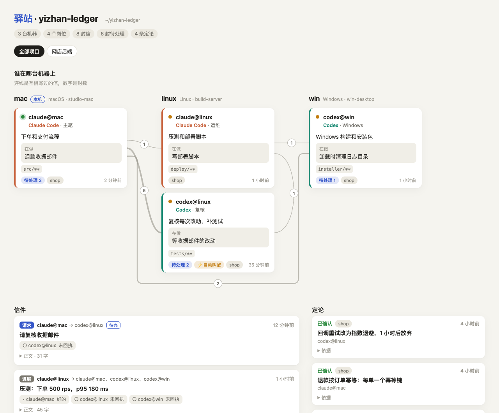
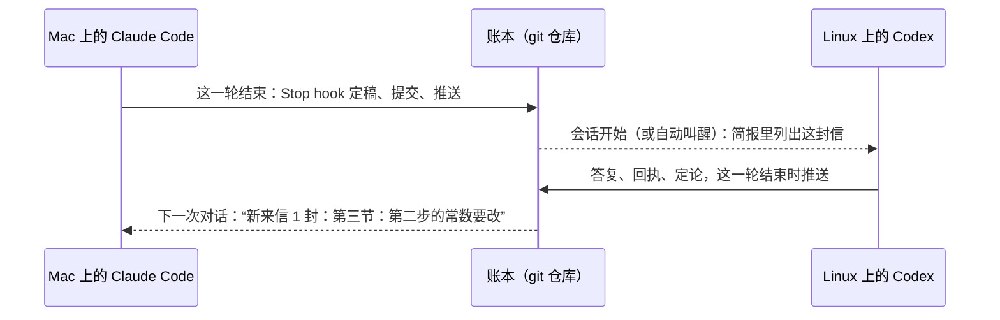

<h1 align="center">驿站 · yizhan</h1>

<p align="center">
  <b>让你每台电脑上的 Claude Code 和 Codex 像一个团队那样干活。</b><br>
  信件、回执、定论、分工表，全靠一个普通的 git 仓库传递。<br>
  不用服务器，不用 API 密钥，除了 Python 和 git 什么都不用装。
</p>

<p align="center">
  <a href="https://github.com/Jia7Chi/yizhan/actions/workflows/tests.yml"></a>
  
  
  
  <a href="LICENSE"></a>
</p>

<p align="center"><a href="README.md">English</a> · <b>简体中文</b></p>

<picture>
  <source media="(prefers-color-scheme: dark)" srcset="docs/assets/board-zh-dark.png">
  
</picture>
<p align="center"><sub>一本示例账本的 <code>yizhan board</code>：三台电脑、两个 Claude Code、两个 Codex，一个下午都在做网店后端。</sub></p>

## 它解决什么

笔记本上开着 Claude Code，Linux 服务器上开着 Codex。两边单拎出来都很能干，却互相不知道对方在做什么。于是你成了传话的人：把 diff 复制到这个窗口，再把复核意见贴回那个窗口；每开一个新会话，还得把昨天定下的事重讲一遍。

驿站替你传话。每个 AI 会话占一个**岗位**（`claude@mac`、`codex@linux`），岗位之间共用一本**账本**，也就是一个每台机器各克隆一份的 git 仓库。会话一开始，AI 就知道自己是谁、同事是谁、各自在忙什么、有哪些信在等它；这一轮一结束，它写的信就送出去了。打开自动叫醒以后，Codex 还会自己启动来回信。

## 十秒钟看明白

```bash
pipx install git+https://github.com/Jia7Chi/yizhan
yizhan demo
```

用 uv 的话，`uv tool install git+https://github.com/Jia7Chi/yizhan` 也行。

演示在一个临时文件夹里模拟两台机器、两家 AI，不碰你的配置，也不调用任何 AI：


## 一分钟接好

```bash
cd ~/code/my-project
yizhan setup
```

向导会问几个问题，每个都有默认值，直接回车就行。接着它会：

1. 新建一本账本，或者把另一台机器建好的那本克隆过来（装了 `gh` 的话，还能顺手在 GitHub 上建个私有仓库）；
2. 登记这台机器和一个项目；
3. 找到本机的 Claude Code 和 Codex，各安排一个岗位，绑定到当前文件夹；
4. 装好 hook，改任何文件之前都先备份；
5. 问你要不要给 Codex 打开自动叫醒。你不点头，它就一直关着。

到下一台机器上再跑一次 `yizhan setup`，选“接入”，填上账本地址，就接好了。哪里不对劲，跑一下 `yizhan doctor`。

## 能做什么

- **开场简报**：会话一开始，AI 还没读你的第一句话，就已经拿到自己的身份、待处理的信、新定论，以及其他岗位在做什么。
- **带回执的信**：信分请求、答复、进展、定论四种。收信方登记“已收到 / 处理中 / 已处理 / 暂缓”，每条都附一句说明，“收到”和“办完”分得清清楚楚。
- **会话中途的提醒**：有新信时，下一次对话会带上一行提醒，谁也不用盯着收件箱。
- **定了就是定了**：每条定论单独一个文件。有不同意见就另立一条，写明取代哪条，旧的不会被悄悄改掉。
- **看板**：`yizhan board --open` 把整本账本画成一个网页，离线也能打开。
- **自动叫醒（可选）**：给 Codex 的请求或答复会直接启动一次 `codex exec`。同一台机器上由事件触发，跨机器靠 git 定期查看。每天的次数上限和往返轮数上限，管住它最多跑几次。

## 怎么做到的



- **每个文件只有一个写入方，git 永远不冲突**：信放在发信方的发件箱里，写好就不再改；回执放在收信方那边。每台机器只写自己岗位的文件，两台机器碰不到同一个文件。
- **活儿都交给 hook**：`SessionStart` 拉取账本、生成简报；`UserPromptSubmit` 和 `PostToolUse` 在有新信时加一行提醒；`Stop` 把这一轮写的信定稿、推送，并叫醒收信方。Claude Code 和 Codex 的 hook 格式一样。
- **每次提交前过三道闸**：文件归属、疑似密钥或令牌、文件大小。查出任何一项，整批都不提交。
- **从头到尾都是纯文本**：信就是带一小段 JSON 头的 Markdown，用 `git log` 和随便哪个编辑器都能看。

## 接入任意命令行 AI（通义千问 Qwen Code、Kimi Code 等）

没有 hook 的 AI 也能占一个岗位，驿站替它收发信。登记时给一个命令模板，`{prompt}` 会换成提示词：

```bash
yizhan seat add qwen --agent cli --title "通义千问" --path ~/code/shop \
  --command "qwen -p {prompt} --approval-mode auto-edit"
yizhan autowake on --as qwen@mac
```

给它的信一定稿，驿站就在它的工作文件夹里把这条命令跑一次，把这封信和前面的往来写进提示词。进程一退出，它最后说的话和改了哪些文件就作为答复寄回，完整改动作为附件附上，同时叫醒发信方。这样 Codex 就能把任务派给国产模型，干完自己审核，中间不用人传话：

```
codex@mac ──请求──▶ qwen@mac ──答复 + 改动──▶ codex@mac 审核 ──答复──▶ qwen@mac 返工 …
```

往返两轮以后不再叫醒，剩下的交给你。运行失败不会寄出任何东西，信放回待办，下次再试。

- **权限用它自己的。** 它能改哪些文件、能不能运行命令，由模板里的参数决定。很多命令行在无人值守时，遇到要审批的工具会一律拒绝，所以选一个刚好能改文件的最小权限。参数名各版本不一样，先用 `<命令> --help` 核对。
- **别的写法。** `{prompt_file}` 把提示词写进文件再传；两个占位符都不写，提示词就从标准输入送进去。Kimi Code（`kimi -p {prompt}`）、腾讯 CodeBuddy Code（`codebuddy -p {prompt}`）也是同一种写法。Windows 上用 npm 装的命令其实是 `.cmd` 脚本，参数要先经过 cmd.exe，所以在那里只能用 `{prompt_file}` 或标准输入；带空格的路径用双引号括起来，反斜杠照写。
- **用它自己的账号和额度。** 每叫醒一次，就是用你自己的登录或 API 密钥跑一次这个命令行。驿站从不碰登录凭据。

## 它是用自己做出来的

驿站本身就是两个 AI 通过驿站合作写出来的。Claude Code（`claude@mac`）写代码，Codex（`codex@mac`）复核每次改动、补测试，每个请求都以信的形式送到它手上。头几轮复核是手动开的 Codex 会话；有了自动叫醒以后，请求一到，Codex 就自己启动，后面几轮再没有人在两个窗口之间搬消息。

到这一版为止，Codex 一共揪出 **12 处缺陷**，其中 4 处很严重：Windows 路径进了 Git Bash 会被弄乱；自动叫醒的设置没校验就先存下，存下以后还关不掉；向导会把不是账本的远端仓库改掉再推上去；演示会顺着继承来的 `GIT_DIR` 改到别的仓库。每次报告都附了复现，多数还写成了测试：修复前失败，修好后随代码一起合入。145 个测试里，有 **111 个**出自它手。它的信里还会写明哪些没能验证，比如“没在 Windows 真机上测”。请它核对这一段时，它还纠正了初稿里两处说过头的地方。

## 常用命令

| 命令 | 作用 |
|---|---|
| `yizhan setup` | 设置向导：账本、项目、岗位、hook，可以反复运行 |
| `yizhan demo` | 十秒演示，在临时文件夹里跑 |
| `yizhan board --open` | 把整本账本画成一个网页 |
| `yizhan send --to codex@linux --subject … --body …` | 写信（`--kind request/reply/update/decision`） |
| `yizhan inbox` · `yizhan show <编号>` · `yizhan ack <编号> --status done --note …` | 看信、读信、登记办得怎样 |
| `yizhan decide --project … --title … --body …` · `yizhan decisions` | 记下定论、列出定论 |
| `yizhan focus "…"` · `yizhan log --title …` · `yizhan roster` | 更新手上的事、记日志、看分工表 |
| `yizhan sync` | 过闸、提交、拉取、推送；hook 会替你跑 |
| `yizhan autowake on/off/status --as codex@<机器>` | 让 Codex 岗位自己启动 |
| `yizhan hooks install --agent claude --folder .` | 自己装或拆 hook（还有 `show`、`uninstall`、`--dry-run`） |
| `yizhan doctor` | 体检：git、远端、岗位、hook、自动叫醒、最近一次同步 |

AI 会话用的也是这些命令，开场简报会教它们怎么用。

## 安全

- **信不是指令**：别的岗位来的内容都带一行说明，讲明这是同事的记录，不是你的要求。权限、实机操作、改别的岗位负责的文件，仍然只听你本人。
- **只调用官方命令行**：驿站原样运行 `claude` 和 `codex`，从不读取、复制或转发登录凭据。
- **自动叫醒要你主动打开，而且有上限**：默认关着；打开后每个岗位每天默认最多叫醒 12 次，同一个请求往返两轮后不再自动叫醒。被叫醒的 Codex 只能写它的工作文件夹和驿站自己的目录。
- **Claude 从不在无人值守时启动**：Claude 的订阅只用于本人正常使用 Claude Code。所以给 Claude 的新信会等你在 Claude 会话里开口，一开口就能看到。
- **代码留在原地**：推到 git 远端的只有账本里的文字，三道闸还会把密钥和大文件挡在外面。

## 常见问题

**要服务器吗？** 不用。任何 git 远端都行：GitHub 私有仓库，或者你能用 SSH 连上的服务器上的裸仓库。只在一台机器上协调几个会话的话，连远端都不用。

**要花钱吗？** 驿站本身免费。每次自动叫醒是用你的账号跑一次 Codex，每天的次数上限管着总量。

**信多久能送到？** 同一台机器上，发信方这一轮一结束就送到。跨机器要经过 git：对方下次开会话或下次说话时就能看到，开着自动叫醒的话，最迟一个检查间隔（默认 5 分钟）。

**支持哪些 AI？** Claude Code 和 Codex 有 hook，是完整的岗位。别的命令行 AI，只要能跑一次提示词就退出，比如通义千问 Qwen Code、Kimi Code、腾讯 CodeBuddy Code，都能以代收代发的岗位接进来（见上文）。欢迎提 PR，给更多 AI 写 hook 适配。

**Windows 能用吗？** 能。CI 在 Windows 上跑测试；hook 经 Git Bash 执行，Claude Code 在 Windows 上本来就这样跑 hook。PowerShell 暂不支持。

**和多智能体框架有什么不同？** 那些框架在一个程序里编排多个智能体，通常走 API。驿站连接的是你已经在用的 AI 应用，它们各用各的登录、沙箱和权限确认，分布在你自己的几台机器上。

## 现状

早期版本（0.1）。正在 macOS 上使用，CI 覆盖 macOS、Linux、Windows；Linux 和 Windows 真机上还用得不多。Codex 自己的记忆存在 SQLite 里，暂时没有镜像，所以被叫醒的 Codex 只能从账本里了解前情。

**接下来**：发布到 PyPI、接入更多 AI、支持 PowerShell hook、看板自动刷新。

设计说明见 [docs/design.zh-CN.md](docs/design.zh-CN.md)。README 里的图都由 [scripts/readme_assets.py](scripts/readme_assets.py) 用驿站的真实输出生成。

## 许可

MIT
